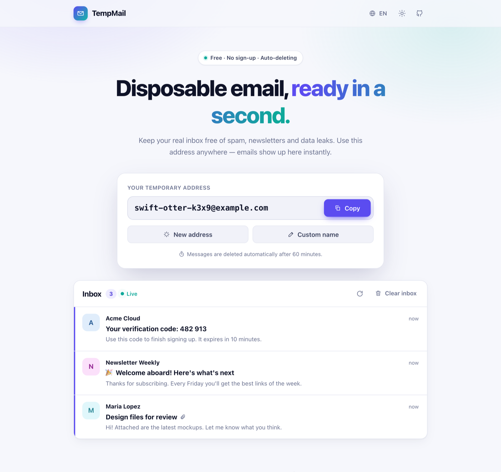
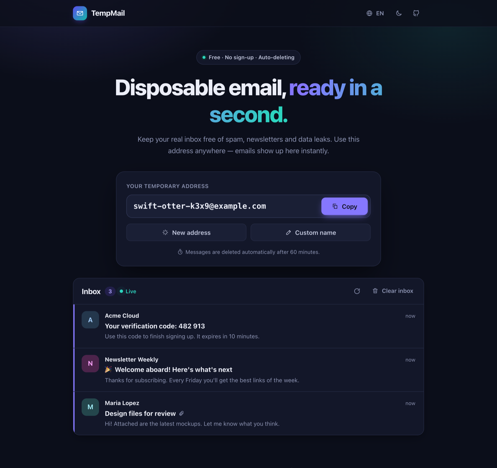
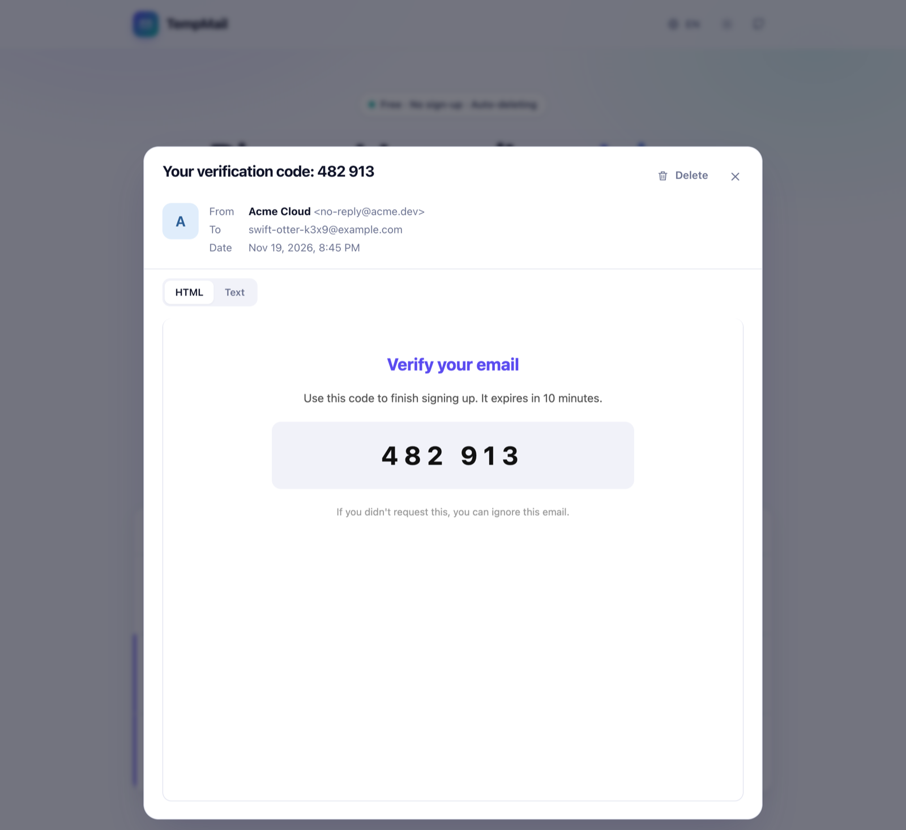

<div align="center">


<h3>Self-hosted disposable email — instant, private and auto-deleting.</h3>

<p>
  Your own temporary-mail service on your own domain. A built-in SMTP server receives mail,<br/>
  and a clean Next.js web app streams it to the browser in real time.
</p>

[](https://github.com/KarolFli/temp-Mail/actions/workflows/ci.yml)
[](LICENSE)
[](https://nextjs.org)
[](https://www.typescriptlang.org)
[](https://nodejs.org)
[](#-quick-start-docker)
[](CONTRIBUTING.md)
[](https://github.com/KarolFli/temp-Mail/stargazers)

[Features](#-features) · [Quick start](#-quick-start-docker) · [DNS setup](#-dns-setup) · [Configuration](#%EF%B8%8F-configuration) · [API](#-rest-api) · [Contributing](CONTRIBUTING.md)

</div>

---

## 📸 Preview

<table>
  <tr>
    <td width="50%"></td>
    <td width="50%"></td>
  </tr>
  <tr>
    <td colspan="2" align="center"></td>
  </tr>
</table>

## ✨ Features

- ⚡ **Real-time inbox** — new emails are pushed to the browser over Server-Sent Events, with automatic reconnect and polling fallback.
- 📨 **Built-in SMTP server** — no Postfix, no external mail provider. Receives mail directly on port 25.
- 🔒 **Safe email rendering** — HTML is shown in a sandboxed iframe with a strict CSP; scripts never run and **remote images (tracking pixels) are blocked** until you allow them.
- 🧹 **Self-destructing** — messages live in memory only and are deleted automatically after a configurable TTL.
- ✏️ **Random or custom addresses** — friendly generated names like `swift-otter-k3x9@your.domain`, or pick your own.
- 🌍 **Multiple domains** — serve any number of domains from one instance.
- 📎 **Attachments** — listed with sizes and downloadable safely.
- 🌗 **Light & dark mode**, 🇬🇧/🇵🇱 **English & Polish**, fully responsive.
- 🐳 **One-command deploy** with Docker; tiny standalone image running as a non-root user.
- 🛡️ **Hardened** — rate limiting, size limits, recipient limits, security headers, no open relay.

## 🧱 Tech stack

| Layer      | Technology                                                                 |
| ---------- | -------------------------------------------------------------------------- |
| Web app    | [Next.js 16](https://nextjs.org) (App Router), React 19, TypeScript        |
| Mail       | [`smtp-server`](https://nodemailer.com/extras/smtp-server/) + [`mailparser`](https://nodemailer.com/extras/mailparser/) |
| Real-time  | Server-Sent Events (Route Handlers + `ReadableStream`)                     |
| Storage    | In-memory store with TTL & LRU-style eviction — nothing is written to disk |
| Testing    | [Vitest](https://vitest.dev) (unit + end-to-end SMTP tests)                |

## 🚀 Quick start (Docker)

```bash
git clone https://github.com/KarolFli/temp-Mail.git
cd temp-Mail
cp .env.example .env        # then set DOMAINS=your-domain.com
docker compose up -d --build
```

- Web UI → `http://127.0.0.1:3000` (put a reverse proxy in front for HTTPS — see [Deployment](#-deployment))
- SMTP → public port **25**

## 💻 Local development

```bash
npm install
cp .env.example .env        # DOMAINS=localhost works out of the box
npm run dev
```

Open <http://localhost:3000>, copy the address and send a test email to the SMTP server on port `2525`:

```bash
# using swaks (brew install swaks / apt install swaks)
swaks --server localhost:2525 --to your-address@localhost --header "Subject: Hello" --body "It works!"
```

| Script              | Description                         |
| ------------------- | ----------------------------------- |
| `npm run dev`       | Dev server with hot reload + SMTP   |
| `npm run build`     | Production build (standalone)       |
| `npm start`         | Run the production build            |
| `npm test`          | Run the test suite                  |
| `npm run typecheck` | TypeScript type checking            |

## 🌐 DNS setup

To receive mail for `example.com` on a server with IP `203.0.113.10`, add these records at your DNS provider:

| Type | Name              | Value                | Notes                                   |
| ---- | ----------------- | -------------------- | --------------------------------------- |
| `A`  | `mail.example.com`| `203.0.113.10`       | Host that runs TempMail                 |
| `MX` | `example.com`     | `mail.example.com`   | Priority `10`                           |
| `A`  | `example.com`     | `203.0.113.10`       | Web UI (or use a subdomain)             |

Then make sure **TCP port 25 is open** in your firewall. Note that many home ISPs and some
cloud providers block inbound port 25 — a VPS is recommended.

> 💡 You can verify delivery with `dig MX example.com` and by sending a message from Gmail.

## ⚙️ Configuration

All options are environment variables (see [`.env.example`](.env.example)).

| Variable                 | Default        | Description                                                        |
| ------------------------ | -------------- | ------------------------------------------------------------------ |
| `DOMAINS`                | `localhost`    | Comma-separated domains to accept mail for. First one is default.  |
| `SITE_NAME`              | `TempMail`     | Name shown in the UI, page title and SMTP banner.                  |
| `PORT`                   | `3000`         | HTTP port of the web app.                                          |
| `SMTP_ENABLED`           | `true`         | Start the built-in SMTP server.                                    |
| `SMTP_HOST`              | `0.0.0.0`      | SMTP bind address.                                                 |
| `SMTP_PORT`              | `2525`         | SMTP port inside the container / process.                          |
| `SMTP_HOSTNAME`          | first domain   | Hostname announced in the SMTP greeting.                           |
| `SMTP_TLS_KEY` / `SMTP_TLS_CERT` | —      | PEM files for STARTTLS (a self-signed cert is used otherwise).     |
| `MESSAGE_TTL_MINUTES`    | `60`           | How long messages are kept.                                        |
| `MAX_MESSAGES_PER_INBOX` | `50`           | Oldest messages are dropped above this limit.                      |
| `MAX_TOTAL_MESSAGES`     | `5000`         | Global cap — protects memory.                                      |
| `MAX_MESSAGE_SIZE_MB`    | `10`           | Larger messages are rejected with `552`.                           |
| `MAX_SSE_CONNECTIONS`    | `1000`         | Maximum concurrent live-inbox connections.                         |

## 📦 Deployment

TempMail should run **behind a reverse proxy** that terminates HTTPS. Ready-made configs:

- [`deploy/Caddyfile`](deploy/Caddyfile) — automatic HTTPS, zero config (recommended)
- [`deploy/nginx.conf`](deploy/nginx.conf) — includes the settings Server-Sent Events need

```bash
# Example with Caddy on the host
sudo caddy run --config deploy/Caddyfile
```

> ⚠️ The rate limiter trusts the right-most `X-Forwarded-For` entry added by your proxy.
> Don't expose port 3000 directly to the internet — the provided `docker-compose.yml` binds it to `127.0.0.1`.

## 🔌 REST API

All endpoints return JSON. `:address` is a full address, e.g. `swift-otter-k3x9@example.com`.

| Method   | Endpoint                                               | Description                                 |
| -------- | ------------------------------------------------------ | ------------------------------------------- |
| `GET`    | `/api/config`                                          | Public config (domains, TTL, size limit)    |
| `GET`    | `/api/generate?domain=`                                | Generate a random address                   |
| `GET`    | `/api/inbox/:address`                                  | List messages (newest first)                |
| `DELETE` | `/api/inbox/:address`                                  | Delete all messages                         |
| `GET`    | `/api/inbox/:address/events`                           | **SSE stream** — `ready`, `message` events  |
| `GET`    | `/api/inbox/:address/messages/:id`                     | Full message (text, HTML, attachments)      |
| `DELETE` | `/api/inbox/:address/messages/:id`                     | Delete a message                            |
| `GET`    | `/api/inbox/:address/messages/:id/attachments/:index`  | Download an attachment                      |
| `GET`    | `/api/health`                                          | Health check & stats                        |

<details>
<summary>Example</summary>

```bash
$ curl -s https://example.com/api/inbox/swift-otter-k3x9@example.com | jq
{
  "address": "swift-otter-k3x9@example.com",
  "messages": [
    {
      "id": "ENxFFt9R6Zjx",
      "from": { "name": "Acme Cloud", "address": "no-reply@acme.dev" },
      "subject": "Your verification code: 482 913",
      "preview": "Use this code to finish signing up. It expires in 10 minutes.",
      "receivedAt": 1795117353476,
      "expiresAt": 1795120953476,
      "attachments": 0,
      "size": 1245
    }
  ]
}
```

</details>

## 🗂️ Project structure

```
src/
├── app/
│   ├── api/                 # REST + SSE route handlers
│   ├── layout.tsx           # Root layout, metadata, theme bootstrap
│   ├── page.tsx             # Landing page
│   └── globals.css          # Design tokens & styles (light/dark)
├── components/              # Mailbox, MessageReader, Header, sections…
├── lib/
│   ├── smtp.ts              # Receive-only SMTP server
│   ├── store.ts             # In-memory mail store with TTL
│   ├── address.ts           # Address validation & generation
│   ├── http.ts              # API helpers & rate limiting
│   ├── config.ts            # Environment configuration
│   └── i18n.ts              # English & Polish translations
└── instrumentation.ts       # Boots the SMTP server with Next.js
test/                        # Vitest unit & SMTP integration tests
deploy/                      # Caddy & nginx examples
```

## 🔐 Security

Inboxes are public to anyone who knows the address — **never use TempMail for banking, important
accounts or password resets you need to keep.** See [SECURITY.md](SECURITY.md) for the full
security model and how to report a vulnerability.

## 🗺️ Roadmap

- [ ] Optional persistent storage (SQLite / Redis)
- [ ] Per-inbox access tokens
- [ ] Browser notifications for new mail
- [ ] Raw `.eml` download
- [ ] More languages

## 🤝 Contributing

Contributions are welcome! Please read [CONTRIBUTING.md](CONTRIBUTING.md) — PRs target the `develop` branch.

## 📄 License

[MIT](LICENSE) © KarolFli
